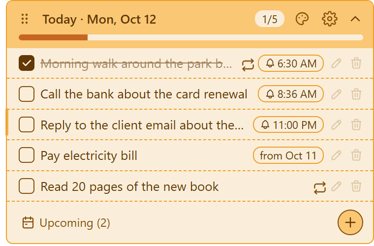
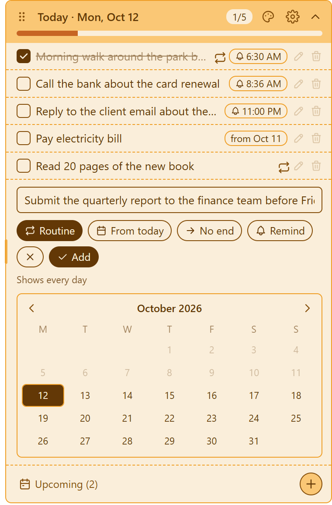
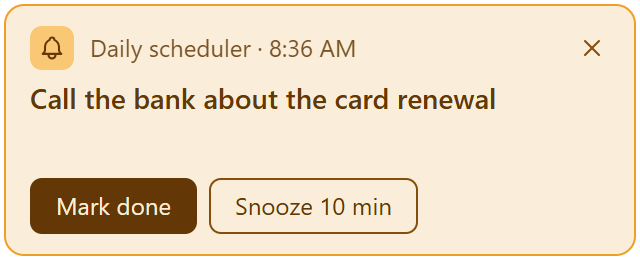

# Daily scheduler

A small sticky note for your desktop that shows today's tasks. It opens when your computer starts, sits on the right of the desktop behind your open apps, and drops down your list when you click it. Works on Windows, macOS and Linux.

<p align="center"></p>

## Features

- **Today only:** the list shows tasks for today plus your routines. Tasks for later dates stay hidden under **Upcoming**.
- **Routines:** tasks that show up every day, from a start date you choose, with an optional end date.
- **Deadlines:** give a task a deadline and it shows every day until you finish it, with a countdown like "3 days left". The countdown turns from green through yellow to red as the deadline gets closer. Tasks without a deadline work as before. If you type a date, like "by 30 October", "Oct 30, 2027", "tomorrow" or "by Friday", the deadline fills in by itself. You can change or remove it.
- **Progress bar:** goes from red when nothing's done to green when everything's done.
- **Roll-over:** unfinished tasks move to the next day, marked with the day they came from.
- **Reminders:** a pop-up at the time you set, with **Mark done** and **Snooze 10 min**. If your computer was off or asleep, missed reminders show as soon as it's back.
- **Edit, delete and undo:** double-click a task (or its pencil) to edit it. Deleting a task gives you a few seconds to undo.
- **Your choice of colour:** yellow, pink, blue, green or lavender.
- **Lives on the desktop:** the note stays behind your apps, so you see it when you minimise them or show the desktop (on Windows it stays visible after Win+D). Click the tray icon to bring it forward, or turn on **Show above other apps** in Settings.
- **Resizable:** drag the left edge to make the note wider, and drag the dots to move it anywhere.
- **Optional Google Tasks sync:** sign in with Google to see and tick your tasks on your phone. The app works fully without signing in.
- **Backup:** export your tasks to a file and import them on another computer.

<p align="center">
  
  
</p>

## Download and install

Download the latest version from the [Releases page](https://github.com/abdullahdmc/daily-scheduler/releases/latest).

| System | File | Notes |
| --- | --- | --- |
| Windows | `Daily-scheduler-…-win-x64.exe` | If Windows SmartScreen warns you, click **More info**, then **Run anyway**. The app isn't code-signed yet. |
| macOS | `Daily-scheduler-…-mac-universal.dmg` | Drag the app to Applications. The first time, right-click it and choose **Open**, because the app isn't notarised by Apple yet. |
| Linux | `.AppImage` or `.deb` | AppImage: make it executable (`chmod +x`) and run it. Debian/Ubuntu: `sudo apt install ./Daily-scheduler-…-linux-amd64.deb` |

The app sets itself to open when you log in. It tells you this the first time it starts, with a button to turn it off, and you can change it later in **Settings**, the gear icon on the note. The app also has a tray icon (the menu bar on macOS) for showing or hiding the note, or for quitting. If you hide the note and can't see a tray icon (some Linux desktops hide them), open the app again from your app menu and the note comes back.

### Uninstalling

- **Windows:** Settings → Apps → Installed apps → Daily scheduler → Uninstall. This also removes the "open when the computer starts" setting.
- **macOS:** quit the app from the menu bar icon, then drag it from Applications to the Trash. Remove it from System Settings → General → Login Items if it's still listed.
- **Linux:** `sudo apt remove daily-scheduler` for the `.deb`, or delete the `.AppImage`. Then delete `~/.config/autostart/daily-scheduler.desktop`.

Your tasks stay in the data folder listed below until you delete it.

## Using Google Tasks (optional)

In **Settings**, choose **Sign in with Google**. The app creates a list called **Daily scheduler** in your Google Tasks and keeps it in sync:

- Ticking a task on your phone ticks it on the desktop, and the other way round.
- Tasks you add to that list on your phone appear in the app.
- Google Tasks has no repeat setting, so each routine is added to the list fresh each day.
- Reminder times stay on the desktop, because Google Tasks only stores the date.

Your tasks are always saved on your computer first. Google is a copy, not a requirement.

## Where your data lives

Tasks are saved in a `data.json` file in the app's data folder:

- Windows: `%APPDATA%\Daily scheduler`
- macOS: `~/Library/Application Support/Daily scheduler`
- Linux: `~/.config/Daily scheduler`

If you sign in, the Google sign-in token is stored next to it, encrypted with your system's keychain when one is available.

## For developers

You need [Node.js](https://nodejs.org/) 20 or newer.

```bash
npm install
npm start          # run the app
npm test           # run the unit tests
npm run dist       # build an installer for the current system into dist/
```

### Turning on Google sign-in

1. In the [Google Cloud console](https://console.cloud.google.com/), create a project and enable the **Google Tasks API**.
2. Set up the **OAuth consent screen**, and add the `.../auth/tasks` scope.
3. Create an **OAuth client ID** of type **Desktop app**.
4. For local runs, copy `config/google.example.json` to `config/google.json` and fill in the ID and secret. That file is ignored by git.
5. For GitHub releases, add `GOOGLE_CLIENT_ID` and `GOOGLE_CLIENT_SECRET` as repository secrets. The release workflow puts them into the build.

While the consent screen is in **Testing** mode, only the test users you list can sign in, and Google may ask them to sign in again every 7 days. To lift that, publish the app on the consent screen. Google may then ask you to verify it.

### Making a release

Update `version` in `package.json`, then push a matching tag:

```bash
git tag v1.0.0
git push origin v1.0.0
```

GitHub Actions builds the Windows, macOS and Linux installers and attaches them to a release for that tag.

## Code signing policy

Free code signing provided by [SignPath.io](https://signpath.io), certificate by [SignPath Foundation](https://signpath.org). This project has applied, and signing starts with the first release after approval. See the full [code signing policy](https://abdullahdmc.github.io/daily-scheduler/code-signing.html), including team roles and privacy.

## Credits

Planned and designed by **Md Abdullah Saeed Khan**. Built with [Claude Code](https://claude.com/claude-code).

## Licence

[MIT](LICENSE) © 2026 Md Abdullah Saeed Khan
